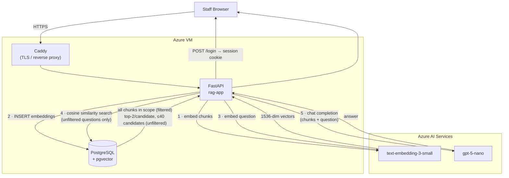

# Resume RAG

<p align="center">
  
  
  
</p>

Upload resumes and ask questions about contents.

**Tech Stack**
- FastAPI
- Azure OpenAI + VM
- PostgreSQL + pgvector
- Docker Compose + Caddy
- Terraform

---

## Architecture



**Ingest (steps 1–2):** PDF upload → chunk text → embed with Azure → store vectors in pgvector

**Query (steps 3–5):** one LLM call per question. Single-resume and tag-filtered questions send every chunk in scope, no ranking or cap. Unfiltered questions take the top 2 chunks from the 40 nearest candidates by cosine similarity; rank/compare/list questions also include a one-line roster of every candidate so none get cut.

---

## Setup

**1. Provision infrastructure**
```bash
cd infra && cp terraform.tfvars.example terraform.tfvars  # fill in values
terraform init && terraform apply
```

**2. Configure the VM's environment**

Copy `.env.example` to `~/.env` on the VM and fill in every variable. The
Azure values come from `terraform output` (`ai_endpoint`, `ai_key`) and the rest
you choose. `DOMAIN` must be a fully-qualified hostname: the session cookie is
`Secure`, so sign-in fails over plain HTTP.

**3. Deploy via CI/CD**

CI authenticates to Azure with a short-lived OIDC token and asks the VM to
deploy itself; the VM pulls the tested commit from GitHub. No secrets are
stored and nothing connects inbound.

```bash
cd infra
gh variable set AZURE_CLIENT_ID       --body "$(terraform output -raw deploy_client_id)"
gh variable set AZURE_TENANT_ID       --body "$(terraform output -raw deploy_tenant_id)"
gh variable set AZURE_SUBSCRIPTION_ID --body "$(terraform output -raw subscription_id)"
```

Push to `main` — the checks run, then the deploy.

---

## Tests

```bash
pip install -r requirements.txt -r requirements-dev.txt
pytest tests/
```

---

## API

| Method | Path | Auth | Description |
|---|---|---|---|
| `GET` | `/` | — | Web UI, or the sign-in page when there is no session |
| `POST` | `/login` | — | Submit password, receive session cookie |
| `POST` | `/logout` | — | Invalidate session cookie |
| `GET` | `/health` | — | Health check |
| `GET` | `/tags` | — | Available tag definitions |
| `GET` | `/resumes` | ✓ | List resumes with status, tags, and contact info |
| `GET` | `/resumes/{id}` | ✓ | Single resume details |
| `GET` | `/resumes/{id}/file` | ✓ | View original PDF inline (`?download=true` to save) |
| `PUT` | `/resumes/{id}/tags` | ✓ | Set tags on a resume |
| `PATCH` | `/resumes/{id}` | ✓ | Correct candidate name, email, or phone |
| `POST` | `/resumes/{id}/retry` | ✓ | Re-run ingest for a failed resume |
| `DELETE` | `/resumes/{id}` | ✓ | Delete resume and its vectors |
| `POST` | `/upload` | ✓ | Upload a PDF resume: one page, text-based, 5 MB max |
| `POST` | `/chat` | ✓ | Ask a question (`resume_id`, `resume_ids`, or `tags` optional); returns `answer` + `sources` |
